<!--
  zahyou v7 のβ版(7.0.0-beta.1。GitHub のプレリリースで出す)の README の下書き(2026-10-16)。
  2026-10-16 の決定を入れた: API キーは［解析］タブの欄(既定のキー入り)/ 描画は DirectX 12 を既定 /
  v7 は当面β版で、v6 の自動更新には出さない(1〜2 か月使ってから正式版 7.0.0)。
  画像を外へ送ることは「同意を取らずに送ってよい」と決まった(2026-10-16 の 2 回目)。何が送られるかと止め方を書く。
  nova へ送るときは「公開しない」の指定(publicly_visible = n)を付ける(2026-10-16 の 3 回目)。それでも第三者に見られうると書く
  (nova のサーバーのコードの読みでは、n でも一覧・画像ファイル・API の結果から完全には隠れない可能性がある。実サイトでは未確認)。
  正式版にするときは、β版のタグへのリンク(releases/tag/v7.0.0-beta.N)を releases/latest に戻し、β版の段落を消す(docs/release-v7.md)。
  数字は docs/rust-port.md の 7.3・9.3・10.6 節の実測(Core Ultra 7 265K)。画面写真は rs/tools/shoot_docs.py で、
  exe の通信を手元で止めて撮ったもの(nova へは何も送っていない)。
-->
# zahyou

天体写真から**いま望遠鏡がどこを向いているか**を割り出し、目標の天体へ
**どちらへどれだけ動かせばよいか**を教えてくれるプログラムです。

星図と写真を見比べて「たぶんこの星だろう」と推測する必要はありません。
矢印の向きにコントローラーを操作するだけで目標を導入できます。
インターネットの無い山の中でも動きます。

| | |
|---|---|
| 入力 | FITS / FIT / JPEG / PNG / TIFF（カラー・動画の 1 コマ・**白地に黒い星の星図**も可） |
| 出力 | 撮影時の向きの画像 + 北を上にした画像 + 赤経赤緯それぞれのずれ |
| 対応画角 | 4′ 〜 2000′（星図データを足せば 2′ まで）|
| 解析時間 | オフライン **0.1 〜 0.4 秒**（0.5 〜 4 メガ画素の実写）、24 メガ画素で約 1.1 秒（Core Ultra 7 265K で実測。下の「実測値」） |
| 大きさ | `zahyou.exe` 1 個・約 13 MB。WSL も Python も要りません |

詳しい説明は
**[導入・運用マニュアル v4（PDF）](天体画像解析プログラム「zahyou」導入・運用マニュアルv4.pdf)**
にあります。
<!-- マニュアルのページ数は、PDF を組み直してから数えて書く(ページ数を書く箇所は README・Release 本文・配布ページの txt) -->

> **v7 から、オフライン解析を zahyou の中の自前のエンジンで行います。**
> v6 までは Windows の中の Linux（WSL）に astrometry.net を入れて頼んでいましたが、
> **v7 は WSL も astrometry.net の実行ファイルも要りません。**星図データ（索引ファイル）は
> 今までと同じ物を同じ場所（`C:\AstrometryData`）で使います。
> プログラムも Rust で書き直し、exe は 102 MB から約 13 MB に、起動は約 4 秒から 1 秒未満になりました。
> しくみは [docs/design-native-solver.md](docs/design-native-solver.md) と [docs/rust-port.md](docs/rust-port.md) にあります。

> **いまの v7 はβ版（7.0.0-beta.1）です。** GitHub の Releases で「Pre-release」の印が付いたものから落とします。
> **v6 の「更新を確認」には出てこない**ので、v6 を使っている人が知らないうちに入れ替わることはありません。
> 1〜2 か月使って安定を確かめてから、正式版（7.0.0）として出します。v6 との行き来は[下記](#v6-とβ版)にあります。

---

# ▶ まずはこちら — デスクトップ版 (exe)

**[Releases（v7.0.0-beta.1）から `zahyou.exe` を落として、ダブルクリックするだけです。](https://github.com/Akashi3060/zahyou/releases/tag/v7.0.0-beta.1)**
Python も VS Code も要りません。インストールも不要で、ファイルは 1 個だけです。

<details>
<summary><b>β版の Release に付けているファイル</b></summary>

| ファイル | 中身 |
|---|---|
| `zahyou.exe` | **これだけで動きます**（デスクトップ版） |
| `zahyou_v7_beta.ipynb` と `zahyou_engine.py` | ノートブック版（[下記](#ノートブック版中身を読んだり書き換えたい人へ)。2 つを同じフォルダーに置く） |
| `zahyou-manual-v4.pdf` | 導入・運用マニュアル v4 |
| `LICENSE.txt` | zahyou のライセンス（MIT） |
| `THIRD-PARTY-NOTICES.md` | `zahyou.exe` に入っているライブラリの一覧とライセンス（exe の［使い方］タブでも読めます） |
| `SHA256SUMS.txt` | 上の全部の SHA256（中身が本物か確かめたいとき） |

</details>

1. `zahyou.exe` をダブルクリック（窓が出るまで 1 秒ほど）
2. **［解析］** タブで「参照...」を押して画像を選ぶ（窓へドラッグしても選べます）
3. 目標の天体名（例 `UCAC4 660-021020`）か、赤経・赤緯を入れる
4. 「解析を実行」

インターネットがあれば、これだけで動きます（オンライン解析の API キーは初めから入っています）。
ネットの無いところで使うなら、下の［準備］タブで星図データを落としておきます。
**ただし、初めて落とすときは Windows が何度か止めます。**次で 1 つずつ通します。

## ⚠ ダウンロードの途中で、Windows が何度か止めます（正常です）

zahyou には**開発元の署名（コード署名証明書）が付いていません**。証明書は毎年
お金がかかるもので、個人が配るソフトには付いていないことがよくあります。

Windows は「まだ広く出回っていないファイル」を見慣れないものとして扱うので、
**ダウンロードから起動までに最大 4 回止められます**。中身を見て危ないと
判断されたわけではありません。順に通し方を示します。
（**作った本人の PC では 1 つも出ません。**）

<!-- 下の 5 枚は v6 の exe を落としたときの Edge と Windows の画面。exe の中身によらない画面なので撮り直していない。
     v7 の exe を落として同じ順に出るかは、Release のあとで別の PC から確かめる(docs/release-v7.md) -->

### 1. 「zahyou.exe で行う操作を選んでください。」→ ［保存］

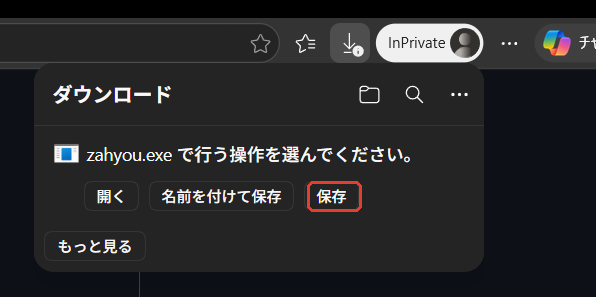

### 2. 「一般的にダウンロードされていません」→ ［…］→ ［保存］

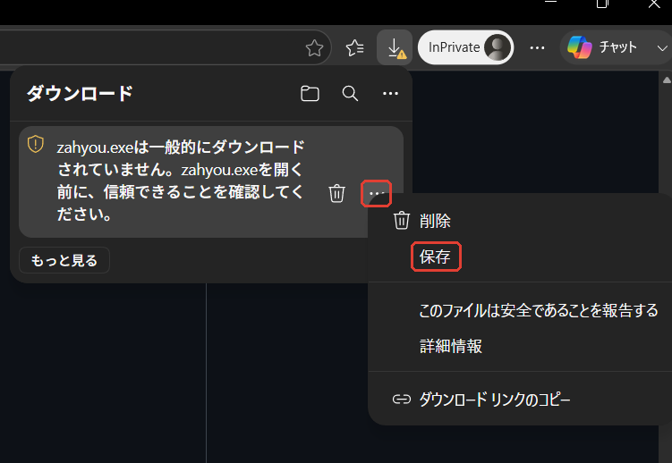

ゴミ箱の右にある **［…］**（その他の操作）を押すと、メニューに **［保存］** が出ます。

### 3. 「開く前に、信頼できることを確認してください」→ ［削除］の ▽ → ［保持する］

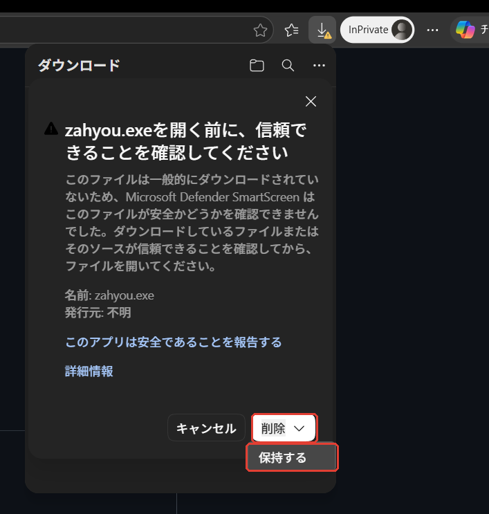

**［保持する］は「削除」ボタンの中に隠れています。** 「削除」の右の **▽** を押すと出ます。
ここまで押して、はじめてファイルが残ります。

> **`zahyou.exe` が見当たらないときは、ここで止まっています。**
> フォルダーに `未確認 841468.crdownload` のような書きかけのファイルが
> 残っているはずです。ダウンロードし直して、上の 3 つを押してください。

### 4. ダウンロード完了 →「ファイルを開く」

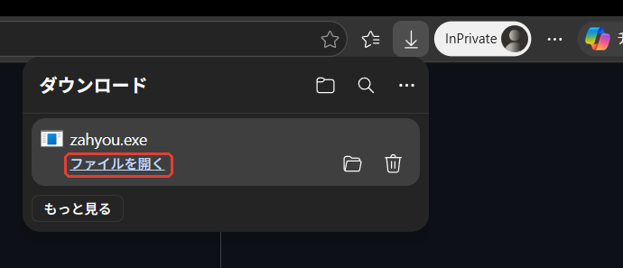

### 5. 青い「Windows によって PC が保護されました」→「詳細情報」→「実行」

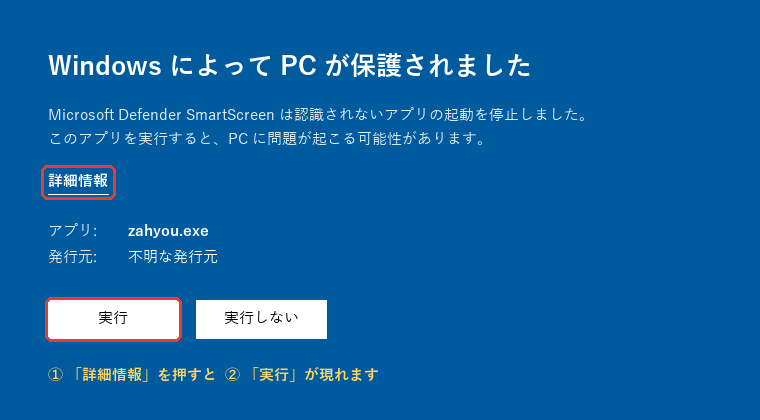

**最初は「実行」ボタンがありません。**「詳細情報」を押すと現れます。
（図は再現したものです）

ここまでで起動します。次からは警告は出ません。

<details>
<summary><b>灰色の「スマート アプリ コントロールが……ブロックしました」が出たとき</b></summary>

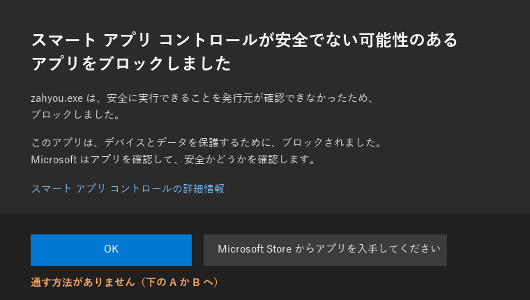

**これだけは通せません。**［OK］と［Microsoft Store からアプリを入手してください］
しかなく、その場で許可する方法が用意されていません。署名の無いアプリを
一律に止める仕組みだからです。Windows 11 を新しく入れた PC で有効に
なっていることがあります。

| | やり方 | 引きかえに |
|---|---|---|
| **A. ノートブック版を使う** | 下の手順へ。exe を使わないので関係ありません | Python と VS Code を入れる手間 |
| **B. 機能をオフにする** | Windows セキュリティ →「アプリ & ブラウザー コントロール」→「スマート アプリ コントロールの設定」→ **オフ** | PC 全体の保護が 1 つ減ります |

スマート アプリ コントロールは**一度オフにすると戻しにくい**作りです
（以前は Windows の入れ直しが要りました。最近の更新が入っていれば
入れ直さずに戻せることもあります）。署名の無いソフトを一律に止める機能なので、
オフにすると zahyou 以外にも効かなくなります。ここは PC を使う本人の判断です。
決めかねるときは A を選んでください。

</details>

<details>
<summary><b>ウイルス対策ソフトに消された／中身が本物か確かめたい</b></summary>

署名の無い、まだ広く出回っていない exe なので、誤検知されることがあります。
その場合はウイルス対策ソフト側で `zahyou.exe` を除外に登録してください。

中身を確かめたい方は、[Releases](https://github.com/Akashi3060/zahyou/releases/tag/v7.0.0-beta.1)
に付けている `SHA256SUMS.txt`（と Release の本文）の SHA256 と、手元のファイルのハッシュを見比べてください。
**確かめなくても使えます。**気になる方向けの補足です。

```powershell
Get-FileHash .\zahyou.exe -Algorithm SHA256
```

</details>

---

## 使い方 — ［解析］タブ

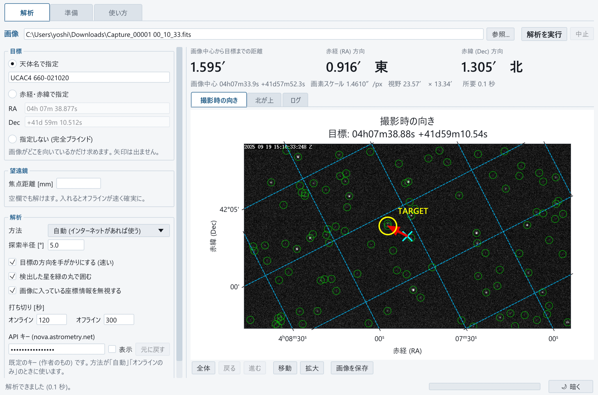

ふだん触るのは**左の列**と**「解析を実行」**だけです。

1. 「参照...」で画像を選ぶ（FITS / FIT / JPEG / PNG / TIFF。窓へドラッグしても選べます）
2. 目標を入れる（天体名か、赤経・赤緯）
3. 「解析を実行」

解析が長引いたら「中止」を押してください。すぐに止まります。

### 出た数字の読み方

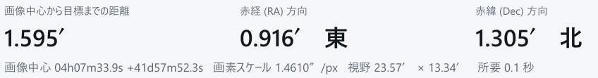

この**3 つが答え**です。いま向いている点（画像の中心）から目標まで、
**赤経方向に 0.916′ 東へ、赤緯方向に 1.305′ 北へ**動かせばよい、という意味です。
下の細い行には、画像中心の座標・画素スケール・視野・かかった時間が出ます。
（この写真はネットにつながっていない状態で撮ったもので、「所要 0.1 秒」はオフラインで解いた時間です。
ネットにつながっていると、天体名を調べ直したり、先にオンライン解析を試したりするぶん延びます）

### 図は 2 枚

**「撮影時の向き」**は撮ったままの向き、**「北が上」**は北を上・東を左にそろえたものです。
赤道儀の軸操作と向きが揃うので、こちらが読みやすい人もいます。
**はじめて使うときは「撮影時の向き」**が開き、切り替えると次からはその表示で出ます。

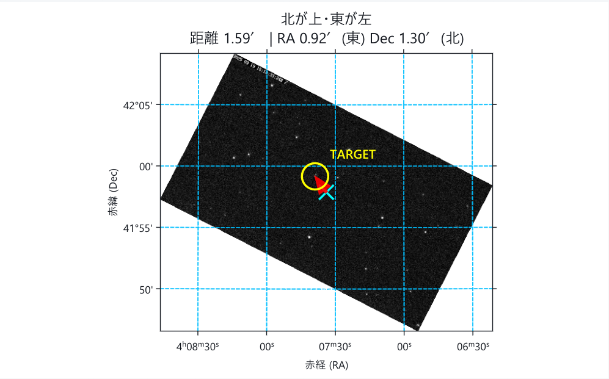

水色の **×** が画像の中心、黄色の **○** が目標、**赤い矢印**が動かす向きです。

図はマウスのホイールで拡大・縮小、ドラッグで移動できます。
図の下のボタンで、拡大して星の位置を確かめたり、PNG で保存したりできます（「全体」で元に戻ります）。


### ネットにつながっているとき（オンライン解析）

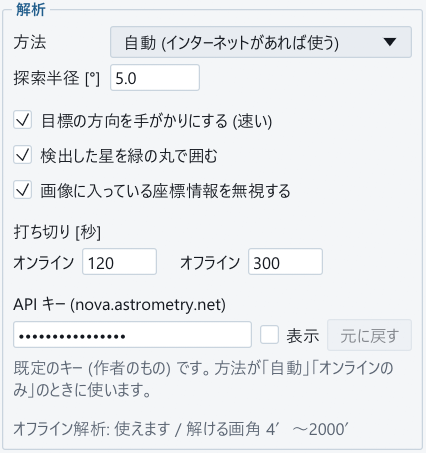

左の列の「方法」が**「自動」**（既定）なら、ネットがあれば先に
[nova.astrometry.net](https://nova.astrometry.net/) に問い合わせ、解けなければ zahyou の中で解きます。

問い合わせに使う **API キー**は、左の列の「打ち切り」の下にある**「API キー」の欄**に入っています
（窓が小さいときは、左の列を下へ送ると出ます）。
**はじめは作者のキー（既定）が入っているので、そのままで使えます。**
自分のキー（nova.astrometry.net に登録すると、自分のページで見られます）を使うなら、欄に貼り付けてください。

- 欄は伏せ字です。「表示」で中身が見え、「元に戻す」で既定のキーに戻ります
- キーは設定（`%LOCALAPPDATA%\zahyou\gui.json`）に覚えます
- **欄を空にすると、ネットがあっても nova.astrometry.net には問い合わせず、はじめからオフラインで解きます**
  （「オンラインのみ」は欄が空だと始められません）

#### nova.astrometry.net へ送るもの

方法が「自動」か「オンラインのみ」で、API キーの欄にキーがあり、ネットにつながっていると、
**送る前に確かめることはせずに**次のものを送ります（v6 と同じです）。

1. まず、**検出した星の位置**（画像の中の座標の一覧）と画像の大きさ。
   目標の方向や画素スケールが分かっていれば、探す範囲の手がかりも送ります
2. 星の位置だけで解けなければ、**画像ファイルそのもの**（ファイル名も）

どちらも「公開しない」の指定（`publicly_visible = n`）を付けて送ります
（付けないと nova の既定で公開になり、API キーの持ち主のアカウント名で nova のサイトの一覧などに載ります）。
**ただし、nova.astrometry.net に送ったものは第三者に見られることがあります**
（nova の仕組み上、一覧や画像ファイルからは完全には隠れない場合があります。zahyou の側からは防げません）。

**送りたくないときは、「方法」を「オフラインのみ」にするか、API キーの欄を空にしてください。**
どちらでも、解析は zahyou の中だけで行い、星の位置も画像も nova.astrometry.net へは送りません（星図データが要ります）。

---

## ネットの無いところで使う — ［準備］タブ

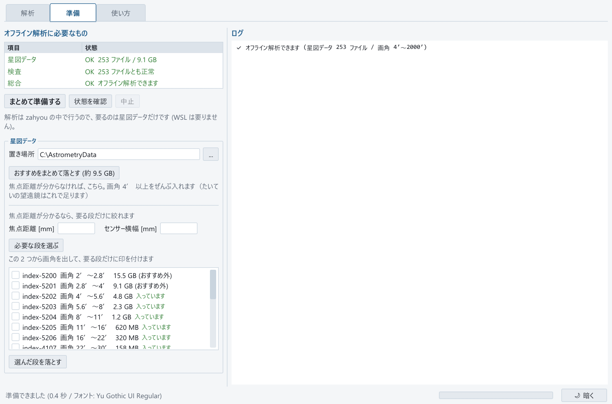

**「まとめて準備する」を押すだけ**です。足りない星図データ（おすすめの段）を落として、
1 本ずつ中身（途中で切れていないか）を検査します（初回のみ。量が多いので、回線によっては数十分かかります）。
一覧表の「総合」が**「オフライン解析できます」**になれば完了です。

一覧表は「星図データ」「検査」「総合」の 3 行です。「状態を確認」を押すと、置き場所のファイルを
数え直して検査し直します。解析のエンジンは zahyou の中に入っているので、
ほかに入れるものはありません（v6 まではここで WSL と astrometry.net も入れていました）。

### 星図データはボタン 2 つ

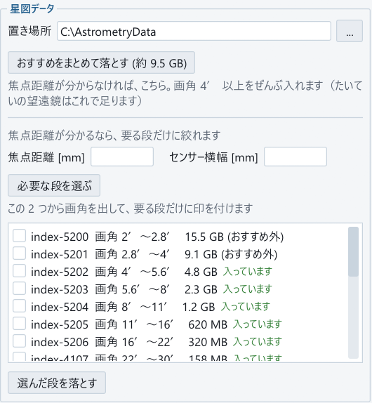

| ボタン | 入るもの | こんなとき |
|---|---|---|
| **おすすめをまとめて落とす** | 画角 **4′ 以上**をぜんぶ（18 段・約 9.5 GB） | **機材の数値が分からない**。数字を何も入れずに押せます |
| 必要な段を選ぶ | その画角に要る段だけ（数百 MB のことも） | 焦点距離とセンサー横幅が分かる／容量を節約したい |

どちらでも、**すでに持っている段は落とし直しません**（一覧の「入っています」が持っている段です）。
途中で止めても、次に押せば続きから落とし直します。
（おすすめ外の 2 段は index-5200 / 5201 で、合わせて 24.6 GB あります）

---

## 暗いところで使う

右下の**「☽ 暗く」**を押すと、画面もタイトルバーも図の中も黒基調になります。
観測中に目が眩みません。**この配色は次に開いたときも残ります。**

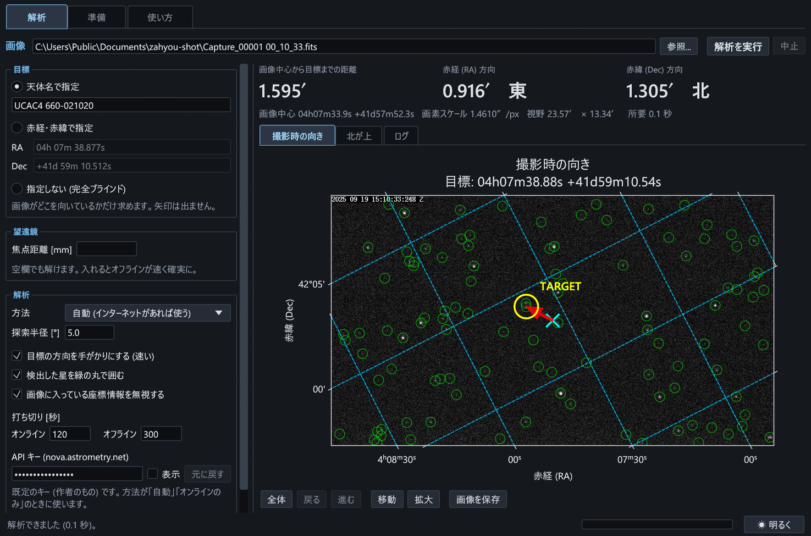

---

## 目標が分からないとき — 完全ブラインド

目標に**「指定しない (完全ブラインド)」**を選ぶと、目標を決めずに
**「この画像はどこを向いているか」だけ**を求めます。矢印は出ません。

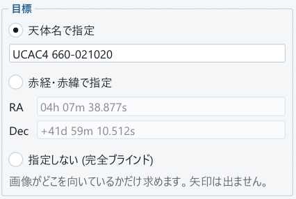

上の 3 つの数字は、**画像中心の赤経・赤緯・画素スケール**に変わります。

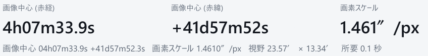

目標が画面の外にあるのか分からないときは、まずこれで向きを確かめてください。
画素スケールが出れば、そこから焦点距離も逆算できます。

---

## 困ったときは — ［使い方］タブ

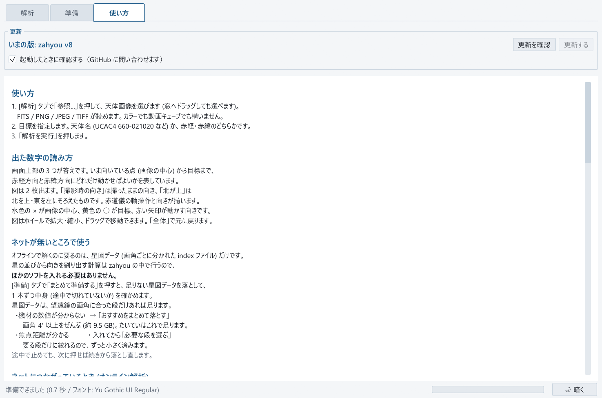

<!-- この写真の「いまの版」は撮った exe の版名(v7.0.0-beta.1)。版を上げたら撮り直す(docs/release-v7.md) -->

操作の要点と、設定の置き場所がまとまっています。
**新しい版への入れ替えも、上の「更新を確認」→「更新する」**でできます（[下記](#入れ替える)）。
β版の間は、手引きの「新しい版に入れ替える / やめる」に、β版と v6 の行き来の説明が出ます。
いちばん下の「同梱しているソフトウェアの表示」を開くと、exe に入っているライブラリの一覧とライセンスが読めます。

### そのほか

| | |
|---|---|
| 大きさ | 約 13 MB（ファイル 1 個） |
| 動作環境 | Windows 11（**x64**）が動く、RAM 8 GB 以上のノート PC を想定（[下記](#動作環境)） |
| オフライン解析 | ［準備］タブで星図データを落とすだけ（画角によって数百 MB 〜 約 9.5 GB） |

中で何をしているかは **[docs/rust-port.md](docs/rust-port.md)**（exe）と
**[docs/design-native-solver.md](docs/design-native-solver.md)**（解き方）に書いてあります。

---

# 動作環境

**想定しているのは、Windows 11 が動く、RAM 8 GB 以上のノート PC** です。

<!-- 最小・推奨の表は載せない(Rust 版は Core Ultra 7 265K でしか測っていない)。想定の PC で測ったら書き足す -->

| | |
|---|---|
| OS | Windows 11（**x64**）。Windows 10 では確かめていません |
| メモリ | 8 GB 以上。zahyou だけが使う分の実測は、下の「実測値」にあります |
| ディスク | `zahyou.exe` 約 13 MB ＋ 星図データ（基本セット 1.2 GB、4′ まで入れるなら 9.1 GB） |
| 画面の描画 | **DirectX 12**（既定）。主の画面をつないでいる GPU で描きます（ノート PC ではふつう内蔵 GPU）。開けなければ OpenGL、それでも開けなければソフトウェア描画（WARP）に自動で切り替えます |
| 画面の大きさ | 窓は 1000 × 660 まで縮められます |
| ネット | オフライン解析だけなら、星図データを落とすときだけ |

> **確かめた PC は 1 台だけです**（Core Ultra 7 265K・20 スレッド・Windows 11。GPU は NVIDIA GeForce RTX 3060 と
> 内蔵の Intel Graphics の両方で描いて確かめました）。描き方の切り替え（DirectX 12 → OpenGL → ソフトウェア描画）は、
> わざと開けなくして確かめてあります。**ノート PC・RAM 8 GB の PC・リモート デスクトップ・GPU のドライバーが無い PC では、
> まだ確かめていません。** どの描き方でも開けないときは、理由を箱で知らせます。

描き方を手で選ぶこともできます（ショートカットのリンク先の後ろに足すなど）。

| 付けるもの | 描き方 |
|---|---|
| `--glow` | OpenGL で描く（開けなくても、ほかの描き方を試さない） |
| `--dx12` | DirectX 12 で描く（同上） |
| `--gpu low` / `--gpu high` | DirectX 12 で、内蔵 GPU / 外付け GPU を先に使う |
| `--gpu warp` | DirectX 12 のソフトウェア描画（GPU を使わない。遅い） |

> **ARM 版の Windows 向けには建てていません。**
> `zahyou.exe` は x64 の exe です。Snapdragon X などの ARM 機での動き方は確かめていません。

<details>
<summary><b>実測値</b></summary>

2026-10-16 に **Core Ultra 7 265K（20 スレッド）・Windows 11** で、ほかの重い処理が動いていないときに測りました。
「Python」は、ノートブック版と同じ Python のエンジン（`dev/` の基準実装）を同じ PC で測った値です。
詳しい条件は [docs/rust-port.md](docs/rust-port.md) の 7.3・9.3・10.6 節にあります
（解析の時間は 7.3 節で、β版で測り直しても差はありませんでした）。

### 解析にかかる時間（画像の読み込みから図まで）

焦点距離も手がかりも入れず、星図データは 4′〜2000′ の全部（253 ファイル）を置いた状態です。

| 画像 | 画素 | exe（v7） | Python |
|---|---|---|---|
| 動画の 1 コマ（FITS）・目標あり | 968 × 548 | 0.12 秒 | 2.13 秒 |
| 同・目標なし | 968 × 548 | 0.09 秒 | 0.69 秒 |
| 16 bit の FITS（IMX432）・目標なし | 1608 × 1104 | 0.11 秒 | 1.54 秒 |
| 星図ソフトが描いた星図（PNG）・目標なし | 2015 × 1001 | 0.31 秒 | 5.75 秒 |
| 彗星の FITS（C2025A6）・目標なし | 2704 × 1536 | 0.36 秒 | 6.09 秒 |
| 24 メガ画素の合成画像・目標あり | 6000 × 4000 | 1.12 秒 | 37.1 秒 |
| 同・目標なし | 6000 × 4000 | 1.07 秒 | 20.5 秒 |
| 焦点距離の書き違い（2500 mm と入力、実際は 818 mm）・目標なし | 968 × 548 | 26.3 秒 | 132.4 秒 |

Python の図の時間は、図を作るまで（画面に描く・PNG にするのは含みません）。
解けない画像は、解析の制限時間（既定 300 秒）まで探して終わります（制限時間を過ぎるのは 0.006 秒以内でした）。
解析中に「中止」を押すと、0.03 秒で止まりました。

### 起動と大きさ

| | exe（v7.0.0-beta.1） | v6 の exe |
|---|---|---|
| 起動 | 最初の描画まで 0.37 〜 0.40 秒（DirectX 12、3 回）<br>0.20 〜 0.21 秒（OpenGL、3 回） | 窓が出るまで約 4 秒 |
| 大きさ | 14,041,088 バイト（約 13 MB） | 約 102 MB |
| 起動のたびの一時展開 | なし | 232 MB |

### メモリと描画

zahyou だけが使う分（私有）と working set（合計）です。合成の FITS を開いて図を拡大・移動させる物差しで、
3 回の中央値を取りました（GPU は NVIDIA GeForce RTX 3060）。

| | DirectX 12（既定） | OpenGL |
|---|---|---|
| 画面を出しただけ（起動から 3 秒） | 248 / 175 MB | 131 / 128 MB |
| 24 メガ画素（6000 × 4000）の図を表示中 | 529 / 324 MB | 457 / 310 MB |
| 61 メガ画素（9504 × 6336）の図を表示中 | 906 / 549 MB | 826 / 493 MB |

- 61 メガ画素の画像を読み込む瞬間の私有の最大は 1,289 〜 1,458 MB でした（DirectX 12）。
- 内蔵 GPU（Intel Graphics）で描くと、描く絵が RAM に載るので working set が大きくなります（61 メガ画素の表示中で 948 MB）。
- 図の拡大・移動のフレームの間隔は、中央値で画面の書き換え 1 回分（75 Hz で 13.3 ミリ秒）でした
  （24・61 メガ画素、DirectX 12・OpenGL・内蔵 GPU とも）。
- 解析そのもののメモリ（Python のエンジンとの比べ）は [docs/rust-port.md](docs/rust-port.md) 7.3 節にあります
  （描き方を今の形にする前の値です）。

CPU のコア数を変えての測定はしていません。

### ディスクの内訳

| 何に使うか | 大きさ | いつ要るか |
|---|---|---|
| `zahyou.exe` | 約 13 MB | いつも |
| 設定と記憶 | 数 KB | いつも |
| 星図データ 基本セット（11′〜2000′） | 1.2 GB | オフライン解析のとき |
| ＋ 4′ まで（5204 / 5203 / 5202） | 計 9.1 GB | 長焦点・切り出しのとき |
| ＋ 2′ まで（5201 / 5200） | 計 34 GB | さらに狭いとき |

**狭い画角ほど重くなります。** 9.1 GB のうち 7.0 GB は index-5202 と 5203（4′〜8′）です。
4′ まで要らなければ、容量は一桁下がります。
配布ページの zip から入れるときは、展開のあいだ zip の分の空きも要ります（［準備］タブで落とすなら要りません）。

</details>

---

# ノートブック版（中身を読んだり、書き換えたい人へ）

**Python で書いた同じ解き方**を、自分で追いたい・書き換えたい人向けの入り口です。
exe（Rust）とノートブック版（Python）は別々に書いたプログラムですが、同じ画像で同じ答えになることを
20 の場面で突き合わせて確かめています（[docs/rust-port.md](docs/rust-port.md) 7.2 節）。
速さは exe のほうが、画像によって 5 〜 33 倍速いです（上の「実測値」）。

**この 2 つを、同じフォルダーに置いてください。**片方だけでは動きません。

| ファイル | 中身 |
|---|---|
| `zahyou_v7_beta.ipynb` | 操作画面（3 つの短いセル） |
| `zahyou_engine.py` | 解析の中身（開く必要はありません） |

**[β版の Release（v7.0.0-beta.1）](https://github.com/Akashi3060/zahyou/releases/tag/v7.0.0-beta.1)から 2 つとも落としてください。**
`zahyou_v7_beta.ipynb` は、リポジトリ直下の `zahyou_v6.ipynb` と同じ中身です（v6 のノートブックと紛れないよう、
名前を変えて配っています。ノートブックはエンジンを `zahyou_engine.py` という名前で探すので、名前を変えても動きます）。
Releases の最新と[配布ページ](https://cloud.akashi-kosaku.uk/s/M2sNsnA2K4oJ4Co)にあるのは v6 のノートブックで、
オフライン解析に WSL と astrometry.net が要る古い版です（下の手順 5 は v7 のノートブックの説明です）。
<!-- 正式版では、Releases の最新と配布ページへのリンクに戻す(資産の名前は zahyou_v7.ipynb。rs/tools/make_release_assets.py が版から決める) -->

以下はノートブック版の導入手順です。**exe を使う方は読む必要はありません。**

---

## 1. 準備するもの

| 項目 | 内容 |
|---|---|
| Python | 3.11 以上（手順 2 で入れます） |
| VS Code | 手順 3 で入れます |
| 天体画像 | FITS / FIT / JPEG / PNG / TIFF。星が 10 個ほど写っていれば十分です |

> **オンラインだけで使うなら、手順 5 は飛ばせます。**
> インターネットにつながる場所でしか使わないなら、星図データ（1.2 GB ほど、細かい段まで入れるなら 9 GB ほど）は要りません。
> あとから追加することもできます。

---

## 2. Python を入れる

1. <https://www.python.org/downloads/> から「Download Python」でインストーラーを落とします。
2. インストーラーの最初の画面で、下にある
   **「Add python.exe to PATH」に必ずチェックを入れて**ください。
   ここを忘れると、あとで Python が見つからないと言われます。
3. 「Install Now」を押して待ちます。

PowerShell で確認できます。

```powershell
python --version
```

`Python 3.11.9` のようにバージョンが出れば成功です。

---

## 3. VS Code を入れる

1. <https://code.visualstudio.com/> からインストーラーを落として実行します（選択肢は既定のままで構いません）。
2. VS Code を起動し、左端の四角が 4 つ並んだアイコン（拡張機能）を押します。
3. 検索欄に **Python** と入れ、Microsoft 製のものを「インストール」。
4. 同じように **Jupyter** も入れます。

---

## 4. ノートブックとライブラリ

1. `zahyou_v7_beta.ipynb` と `zahyou_engine.py` を同じフォルダーに置きます。
2. `zahyou_v7_beta.ipynb` を右クリック →「プログラムから開く」→ VS Code。
3. 画面右上の「カーネルの選択」→ **Python 環境** → 入れた Python を選びます。
4. **セル A** の中の `!pip install` で始まる行の `#` を消して、セルを実行
   （左端の ▷ または `Shift+Enter`）。
5. 終わったら `#` を戻します。次からは実行のたびに入れ直さずに済みます。

```
!pip install astroquery astropy matplotlib Pillow reproject ipywidgets scipy
```

ここまでで**オンライン解析は動きます。** 一度試してみてください。

---

## 5. オフラインでも使う場合 — 星図データを置く

オフライン解析のエンジンも `zahyou_engine.py` に入っています。
**WSL も astrometry.net も入れる必要はありません。** 要るのは星図データ
（astrometry.net の索引ファイル。v6 と同じ物）だけです。

C ドライブの直下に `AstrometryData` フォルダーを作り
（＝ `C:\AstrometryData`）、必要な zip を
[配布ページ](https://cloud.akashi-kosaku.uk/s/M2sNsnA2K4oJ4Co)
から落として **`C:\` の直下に展開**します。
`C:\AstrometryData\index-5205-00.fits` のようになれば正解です。

**使う望遠鏡の画角によって必要なものが変わります。**
大事なのは**「短いほうの辺」の画角**です。星の並び（四角形）は
短辺に収まる大きさまでしか作れないので、必要な段は短辺で決まります
（切り出していない普通の画像でも同じです）。

| zip | 対応する画角 | ASI290MM 全画面での焦点距離 | サイズ |
|---|---|---|---|
| `AstrometryData.zip`（基本セット） | 11′ 〜 2000′ | 〜 990 mm | 869 MB |
| `AstrometryData-index-5204.zip` | 8′ 〜 11′ | 990 〜 1360 mm | 868 MB |
| `AstrometryData-index-5203.zip` | 5.6′ 〜 8′ | 1360 〜 1950 mm | 1.7 GB |
| `AstrometryData-index-5202.zip` | 4′ 〜 5.6′ | 1950 〜 2730 mm | 3.4 GB |

短辺の画角は `画像の高さ[px] × 206.265 × 画素サイズ[µm] ÷ 焦点距離[mm] ÷ 60` 分角です。
足りないときは、解析に失敗したときの画面が必要なファイル名を教えてくれます。

> **実測した例（v6 で）。** 焦点距離 818 mm・968 × 548 画素（普通の 16:9）の画像は、
> 横幅 23.6′ なので `index-4107`（22′〜30′）で足りるはずでした。
> ところが時間をかけても解けず、短辺 13.4′ に合う `index-5205`（11′〜16′）を
> 足したら解けました。

### 置き場所を変えるとき

既定の置き場所は `C:\AstrometryData` です。別の場所（外付けのドライブなど）に置いたときは、
**セル C** の `INDEX_DIR` にその場所を書きます。

```python
INDEX_DIR = r'D:\AstrometryData'
```

デスクトップ版の［準備］タブで落とした星図データも同じ形で置かれるので、
同じフォルダーをそのまま使えます。

---

## ノートブック版の使い方

1. **セル A** を実行（準備。開いた最初の 1 回だけ）
2. **セル B** を実行してボタンで画像を選ぶ
3. **セル C** に目標を書いて実行 → すぐ下に結果と矢印が出ます

2 回目からは**セル C だけ**を実行し直せば十分です。
別の画像に変えるときは、セル B で選び直してからセル C を実行します。

画面が長いと感じたら、**コードの行の左はし**にマウスを近づけると出る `∨` を押してください。
その行から下のひとかたまりが 1 行に縮み、左は `>`、行末は `⋯` になります（もう一度押すと開きます）。
畳んでも実行される中身は変わりません。
なお、実行ボタン `▷` のすぐ右にある `∨` は「デバッグ」のメニューで、折りたたみではありません。

書き換えるのはセル C だけで、よく使うのは次の 3 つです。

| 設定 | 意味 |
|---|---|
| `INPUT_MODE` | 目標を天体名で指定（`'STAR_NAME'`）／赤経赤緯で指定（`'COORDS'`）／目標を決めない（`'NONE'` = 完全ブラインド。画像の向きだけ求めます）|
| `TARGET_STAR_NAME` | 目標の天体名。UCAC4 や TYC などのカタログ名、一般的な名前が使えます |
| `FOCAL_LENGTH_MM` | 望遠鏡の焦点距離。**書かなくても動きます**が、書くとオフラインが速く確実になります |

出力のいちばん大事なところは、図の下に出るこの 3 行です。

```
  画像中心から目標までのずれ
    全角距離      : 1.595'  (95.7")
    赤経(RA) 方向 : 0.916' 東へ
    赤緯(Dec)方向 : 1.305' 北へ
```

この例なら、赤経を東へ 0.92 分角、赤緯を北へ 1.3 分角動かせば目標が中心に来ます。

---

## うまくいかないとき

| 症状 | 対処 |
|---|---|
| 目標がどこにあるか分からない | 目標を `'NONE'`（exe なら「指定しない (完全ブラインド)」）にすると、画像の向きだけを求められます |
| 画面を切り出していて解けない | 星の並びは**短いほうの辺**に収まる大きさまでしか作れません。短辺の画角に合う星図データが要ります（マニュアル 6.1） |
| 「画像が選ばれていません」 | セル B のボタンで選ぶか、セル C の `IMAGE_PATH` にパスを直接書く |
| 解析に失敗する（星が少ない） | 露出を伸ばす・ピントを合わせる・雲を確認する。画面に「星を◯個検出」と出ます |
| 解析に失敗する（画角が合わない） | 手順 5 の表を見て星図データを追加する。失敗時のメッセージに必要なファイル名が出ます |
| `zahyou_engine.py` が見つかりません | ノートブックと同じフォルダーに置く |
| オフラインで星図データが見つからない・壊れていると出る | 置き場所を確かめる（既定 `C:\AstrometryData`。ノートブック版はセル C の `INDEX_DIR`、exe は［準備］タブの欄）。途中で切れたファイルは消して落とし直す（exe なら［準備］タブの「状態を確認」で検査できます） |
| 「星図データを今は開けないので、この探索では使いません」（exe） | ほかのプログラムがその星図データを書き込み用に開いています（コピーや展開の途中など）。終わるのを待ってから解き直してください |
| オフライン解析がとても遅い | 焦点距離（exe は左の列、ノートブック版は `FOCAL_LENGTH_MM`）を書くと探索範囲が決まり、大幅に速くなります |
| 「API キーが空です」と出て「オンラインのみ」が始まらない（exe） | API キーの欄が空です。「元に戻す」で既定のキーに戻すか、自分のキーを入れてください（［解析］タブの「ネットにつながっているとき」） |
| exe の画面が開かず、箱が出る | DirectX 12 → OpenGL → ソフトウェア描画の順に試して、どれでも開けなかったときに理由を箱で出します。グラフィックスのドライバーを更新すると開くことがあります |
| exe の図を動かすのが遅い・画面がおかしい | 描き方を替えて試せます（「動作環境」の `--glow`・`--gpu`）。作者に知らせるときは、［解析］タブの「ログ」の 2 行目（「描画: …」）を写して添えてください |

さらに詳しくは
[マニュアル v4](天体画像解析プログラム「zahyou」導入・運用マニュアルv4.pdf)
の 8 章「うまくいかないとき」をご覧ください。

---

## 新しい版に入れ替える / やめる

### 入れ替える

**［使い方］タブの「更新を確認」→「更新する」を押すだけ**です。
GitHub に新しい版があるかを聞き、あれば落として入れ替え、起動し直します。
落としたものは入れ替える前に**大きさと SHA256 で中身を確かめ**、違えば捨てます。

いままでの版は、入れ替えのあいだだけ `zahyou.exe.old` として横に残り、**次に起動したときに消えます**
（v6 までは `zahyou.exe.bak` として残していました）。前の版に戻したいときは、
[Releases](https://github.com/Akashi3060/zahyou/releases) から落としてください。

起動したときにも自動で確認します（新しい版があるときだけ知らせます）。
確認をやめたいときは、同じところのチェックを外してください。
`zahyou.exe` を書き込めない場所（Program Files など）に置いていると、ボタンでは入れ替えられません。

手で入れ替えるなら、[Releases](https://github.com/Akashi3060/zahyou/releases)
から新しい `zahyou.exe` を落として、古いものに上書きするだけです。

設定（目標・焦点距離・配色・API キー）も、覚えた座標や画素スケールもそのまま引き継がれます。
v6 で方法を「オフライン (WSL) のみ」にしていたら、v7 でも「オフラインのみ」として読みます
（設定ファイルには v6 と同じ書き方で書くので、v6 に戻しても方法は変わりません）。
星図データも**そのままで構いません**（v6 と同じ物を同じ場所で使います）。
いま使っている版はウィンドウの題（`zahyou v7.0.0-beta.1 (β版) — …` のように）で分かります。

### v6 とβ版

- **β版の間、「更新を確認」は GitHub の Releases から次のβ版と v7 の正式版を探します。**
- **v6 の「更新を確認」には、β版は出てきません。** β版を試すときは、Releases の「Pre-release」の印が付いた
  `v7.0.0-beta.N` から `zahyou.exe` を落として、v6 の `zahyou.exe` に上書きします
  （v6 の exe を別の場所に写しておくと、すぐ戻せます）。
- **v6 に戻すとき**は、v6 の `zahyou.exe` を上書きするだけです。設定はそのまま使えます。
  API キーの欄の値は v6 では使わず、v6 で設定を保存すると消えます（次に v7 を開くと既定のキーに戻ります）。
- **v7 の正式版が出ると、v6 の「更新する」でも v7 に入れ替わります。** そのとき v6 の exe が `zahyou.exe.bak`
  （約 102 MB）として横に残ります（v7 はこれを消しません）。v7 が動いたら消してかまいません。

ノートブック版は、ノートブック（`zahyou_v7_beta.ipynb`）と `zahyou_engine.py` の**両方**を入れ替えて、
ノートブックを開き直してセル A からやり直してください（組で動くため）。

### やめる（アンインストール）

インストールしていないので、**置いたものを消すだけ**です。

| 消すもの | 場所 | 大きさ |
|---|---|---|
| 本体 | `zahyou.exe` を置いた場所 | 約 13 MB |
| 設定と記憶 | `%LOCALAPPDATA%\zahyou`（下で説明します） | 数 KB |
| 星図データ | `C:\AstrometryData` | 数 GB |

`%LOCALAPPDATA%` は Windows の書き方で、実際にはこういう場所です。

```
%LOCALAPPDATA%\zahyou

  ↓ Windows に taro という名前で入っているなら

C:\Users\taro\AppData\Local\zahyou
```

**`AppData` は隠しフォルダー**なので、`C:\Users\（名前）` を
開いてもたどれません。エクスプローラーの**アドレス欄**に
`%LOCALAPPDATA%\zahyou` と打つか、**Windows キー + R** で
同じものを打つと一発で開きます。
自分の名前が分からないときは `C:\Users` を開いてください。
［使い方］タブには、その PC での実際の場所が出ています。

### v6 で WSL に入れた astrometry.net

v6 までは、オフライン解析のために［準備］タブ（ノートブック版は `dev\setup_wsl.ps1`）が
WSL の Ubuntu へ astrometry.net を入れていました。**v7 ではもう使いません。**
残しておいても害はありません。片付けるなら、Ubuntu のターミナルで**どちらか一方**を:

```bash
# (1) astrometry.net を消す (設定ファイルも一緒に消える。zahyou が残した退避ファイルも消す)
sudo apt remove --purge astrometry.net
sudo rm /etc/astrometry.cfg.bak-zahyou
```

```bash
# (2) astrometry.net はほかの用事に残し、設定だけ zahyou が書き換える前に戻す
sudo cp /etc/astrometry.cfg.bak-zahyou /etc/astrometry.cfg
sudo rm /etc/astrometry.cfg.bak-zahyou
```

`.bak-zahyou` は、v6 が `/etc/astrometry.cfg` を書き換える前に自動で退避したものです。
(1) の `--purge` は `/etc/astrometry.cfg` も消すので、そのあとで退避ファイルを書き戻す必要はありません。

**WSL 自体はほかの用事にも使うので、消す前によく確かめてください。**
zahyou のためだけに入れて、ほかに使っていないのなら `wsl --unregister Ubuntu`
（中身が全部消えます・戻せません）、Windows から WSL ごと外すなら `wsl --uninstall` です。

---

## 中身に興味がある方へ

- [`docs/rust-port.md`](docs/rust-port.md) — exe（Rust 版）の設計・試験・実測値
- [`docs/design-native-solver.md`](docs/design-native-solver.md) — 自前の解析エンジンの設計（解き方の基準は Python 版）
- [`docs/index-format.md`](docs/index-format.md) — 星図データ（索引ファイル）の形式。実物を読んで調べたもの
- [`rs/`](rs/) — exe のソース（cargo のワークスペース）。ビルドと試験の手順は [rs/README.md](rs/README.md)
- [`CODE_REVIEW_v5.md`](CODE_REVIEW_v5.md) — v5 で何が壊れていたか、v6 で何を直したか
- [`gui/`](gui/) — v6 と試作版（v7-dev）の Python の画面と、それを exe に固めるスクリプト
- [`dev/`](dev/) — `zahyou_v6.ipynb` と `zahyou_engine.py` の生成元（解析エンジン `solver_*.py` を含む）、
  検証用スクリプト、星図データの取得スクリプト、マニュアルの組版

```
cd rs && cargo build --release -p zahyou   # exe を建てる (MSYS2 UCRT64 の Rust。rs/README.md)
cd rs && cargo test --workspace            # exe の試験
python dev/build_nb.py             # 直下の zahyou_engine.py と zahyou_v6.ipynb (セルの中身だけ) を作り直す
python dev/test_robust.py          # いろいろな画像で星が検出できるか
python dev/test_solver_synth.py    # 星図データから作った正解つきの星野を、自前のエンジンで解く
python dev/test_solver_real.py     # 実写を解いて、v6 で求めた正解と比べる (下の注)
python dev/make_manual.py          # マニュアル PDF を組む
python rs/tools/shoot_docs.py      # README とマニュアルの画面写真を exe で撮り直す
python rs/tools/make_release_assets.py --exe <zahyou.exe> --out <フォルダー>   # Release の資産をそろえて検査し、SHA256SUMS.txt を作る
```

試験の一覧は [dev/README.md](dev/README.md) と [rs/README.md](rs/README.md) にあります。
`test_solver_real.py` の実写の画像はリポジトリに入れていません。作者の PC 以外で走るのは、
`test_robust.py` が作る `dev/tcase` の画像 (解けてはいけない画像) だけです。ほかの画像は、
リポジトリの中 (`dev/realcase` など。git には入れていない) か、環境変数 `ZAHYOU_TEST_IMAGES`
(既定はホームフォルダー) の下に、正解ファイル `dev/solver_truth.json` の path と同じ並びで置けば走ります。
陽性の画像が 1 枚も走らなかったときは、そう表示して終了コード 2 で終わります。

---

## ライセンス

zahyou 自身のソースコードは **MIT ライセンス**です（[LICENSE](LICENSE)）。
自由に使って、書き換えて、配ってかまいません。著作権表示だけ残してください。

> Copyright (c) 2025-2026 藤川 至誠（Yoshitaka Fujikawa）/
> AstroKIT, 九州工業大学

**同梱物・外部データはこの限りではありません。**
`zahyou.exe` に入っている第三者のソフトウェアの一覧と、同梱していないもの
（星図データ・星表）の扱い、解き方の出典は
**[rs/THIRD-PARTY-NOTICES.md](rs/THIRD-PARTY-NOTICES.md)** にまとめてあります
（同じものが exe の［使い方］タブでも読めます）。

| | |
|---|---|
| zahyou のコード | MIT（オフライン解析のエンジン `rs/crates/zahyou-solver` ほかと、Python 版の `dev/solver_*.py` を含みます） |
| `zahyou.exe` に入っている Rust のクレート 213 個と、画面の既定の書体 | MIT / Apache-2.0 / BSD / ISC / Zlib / SIL OFL ほか（**GPL・LGPL・MPL は含みません**）。リンクのときに入る GCC の実行時ライブラリは、GPL に「実行時ライブラリ例外」が付いたもので、exe の配り方に制限はかかりません |
| オフライン解析の解き方 | astrometry.net の方式（Lang et al. 2010）を、論文と、astrometry.net の公開文書と BSD-3 の部分のソースを読んでまとめた調べ物（コードは写していません。GPL の部分は読んでいません）をもとに自分で書き直したもの。astrometry.net のコードは含まず、呼び出しもしません |
| 星図データ（index ファイル） | **exe には同梱していません**。exe は［準備］タブが原典（nersc / data.astrometry.net）から落とします。ノートブック版向けに配布ページに置いた zip は、作者が原典をそのまま詰め直したものです。Tycho-2 / Gaia DR2 由来で、元の星表の条件がそのままかかります（Gaia のデータは CC BY-NC 3.0 IGO。商用利用には ESA の許可が要り、クレジットは ESA/Gaia/DPAC） |

ノートブック版が使う Python のライブラリ（pip で入れるもの）は、それぞれのライセンスに従います。
試作版（v7-dev）の Python の exe の同梱物は [THIRD-PARTY-NOTICES.md](THIRD-PARTY-NOTICES.md) にあります。

## 出典

- オフライン解析の解き方: Lang, D., Hogg, D. W., Mierle, K., Blanton, M., & Roweis, S. 2010, AJ 139, 1782
  （[Astrometry.net](https://astrometry.net/)）
- オンライン解析: Astrometry.net の Web サービス（nova.astrometry.net）
- 星図データ: [5200 シリーズ LITE](https://portal.nersc.gov/project/cosmo/temp/dstn/index-5200/LITE/)
  （Gaia DR2 + Tycho-2）／ [4100 シリーズ](https://data.astrometry.net/4100/)（Tycho-2）
  - Tycho-2: Høg, E. et al. 2000, A&A 355, L27
  - Gaia: Gaia Collaboration, Prusti, T. et al. 2016, A&A 595, A1 ／ Gaia Collaboration, Brown, A. G. A. et al. 2018, A&A 616, A1
- 天体名から座標: SIMBAD・VizieR（CDS, ストラスブール）
- exe: egui・eframe / wgpu / tiny-skia / image / ureq・rustls / rayon / memmap2 ほか（一覧は rs/THIRD-PARTY-NOTICES.md）
- ノートブック版: Astropy / SciPy / NumPy / matplotlib / Pillow / reproject

> This research has made use of the SIMBAD database and the VizieR catalogue
> access tool, operated at CDS, Strasbourg, France.

> This work has made use of data from the European Space Agency (ESA) mission
> Gaia (https://www.cosmos.esa.int/gaia), processed by the Gaia Data Processing
> and Analysis Consortium (DPAC, https://www.cosmos.esa.int/web/gaia/dpac/consortium).
> Funding for the DPAC has been provided by national institutions, in particular
> the institutions participating in the Gaia Multilateral Agreement.
